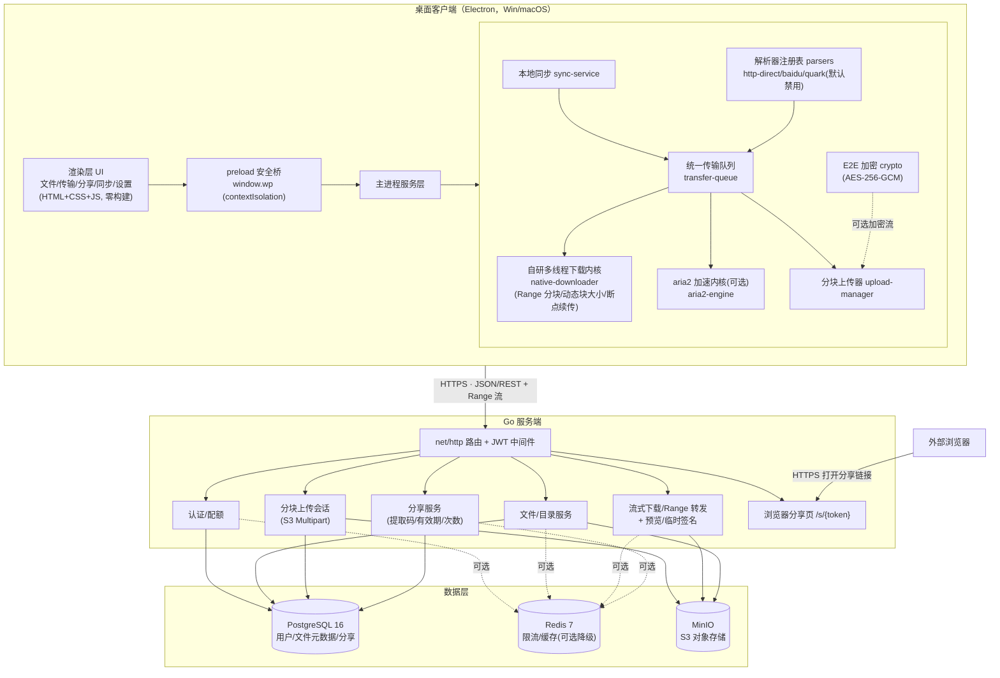
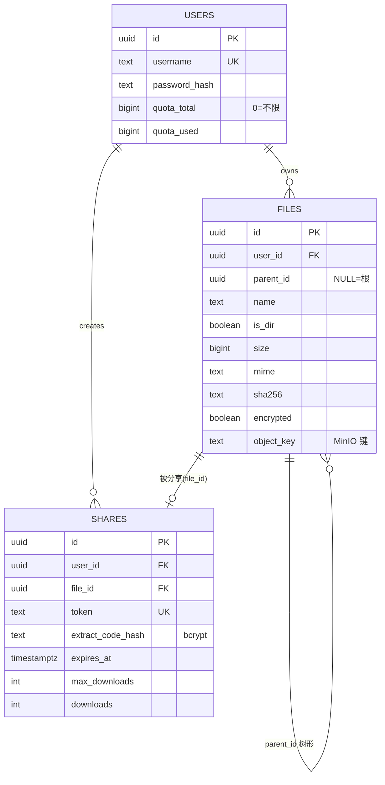

# 云栖盘（YunXi Drive）· 系统架构设计

> 版本 1.0 ｜ 范围：Windows 10+ / macOS 12+ 桌面云盘客户端 + Go 私有云服务端
> 本文档与 [REST API 契约](02-api-spec.md) 共同构成项目设计基线。

## 0. 合规声明（设计红线）

1. 本项目不包含任何破解、反编译、绕过平台鉴权、篡改官方客户端的功能。
2. 「跨网盘下载优化」仅处理**公开分享链接**：只读取匿名访客即可访问的公开页面与官方公开接口返回的内容；提取码由用户主动提供，仅调用页面自身同源的公开校验接口。
3. 解析器与 aria2 加速内核**默认禁用**、可独立启停；禁用后私有云盘全部功能（上传/下载/管理/分享/同步）不受任何影响。
4. 传输仅用标准 HTTP/HTTPS + Range 分块，下载速度只取决于用户本地带宽与服务器/源站带宽，本软件自身不做任何限速或“破解限速”行为。

## 1. 总体架构



**链路说明**：客户端所有请求都打到 Go 网关（单体式 API 服务，天然无跨域与鉴权碎片化问题）；元数据在 PostgreSQL，文件实体在 MinIO（S3 兼容），Redis 承担限流与热点缓存、未配置时全链路优雅降级；对象上传用 S3 Multipart 实现服务端断点续传，下载由网关把客户端 Range 请求流式转发到 MinIO。

## 2. 模块划分

### 2.1 客户端（Electron）

| 模块 | 文件 | 职责 |
|---|---|---|
| 主进程入口 | electron/main.js | 单实例锁、窗口、服务装配、崩溃恢复（重启续传） |
| 安全桥 | electron/preload.js | contextBridge 暴露白名单 IPC，渲染层零 Node 权限 |
| IPC 总线 | electron/ipc.js | 单一 invoke 入口 → 各服务分发；事件经 webContents 推送 |
| API 客户端 | services/api-client.js | REST 封装、Bearer 注入、错误规整、超时 |
| 配置中心 | services/settings.js | 主题/并发/线程/限速/内核开关/解析器开关/E2E |
| 任务持久化 | services/task-store.js | 传输任务 JSON 落盘（原子写），崩溃恢复数据源 |
| **统一传输队列** | services/transfer-queue.js | 上传+下载+直链三类任务统一调度、并发控制、速度聚合 |
| **自研下载内核** | services/native-downloader.js | 多线程 Range 分块、慢块自适应再分块、控制文件断点续传 |
| **aria2 加速内核** | services/aria2-engine.js | 可选：aria2c JSON-RPC 原始取数，调度仍归队列/引擎门面 |
| 下载引擎门面 | services/download-engine.js | 内核选择与回退（aria2 不可用自动回落自研内核） |
| 分块上传器 | services/upload-manager.js | 8MiB 分块（5~64MiB 可配）、跳过已传块续传、sha256 校验 |
| E2E 加密 | services/crypto.js | AES-256-GCM 流式加解密（WPENC1 容器格式） |
| 本地同步 | services/sync-service.js | 双向/单向同步、快照 diff、冲突改名 |
| 解析器注册表 | parsers/registry.js | 按设置启停解析器（**模块级禁用开关**） |
| 通用直链解析 | parsers/http-direct.js | 合规参考实现：公开 HTTP 直链探针 |
| 平台适配骨架 | parsers/baidu.js、quark.js | 仅公开匿名内容；默认禁用；无任何逆向签名 |
| 渲染层 | renderer/ | 登录/文件/传输/分享/同步/设置/解析 七个视图 |

### 2.2 服务端（Go）

| 模块 | 目录 | 职责 |
|---|---|---|
| 启动装配 | cmd/server/main.go | 配置→连库→迁移→路由→优雅退出 |
| 配置 | internal/config | 环境变量驱动，12-Factor |
| 存储层 | internal/store | PostgreSQL：users/files/shares 三表 + 事务 |
| 对象层 | internal/object | MinIO S3：Multipart 五方法 + Range GetObject + 批量删除 |
| 缓存层 | internal/cache | Redis 可选：限流/热点缓存，no-op 降级 |
| 令牌层 | internal/token | JWT 签发校验 + preview-token HMAC 短签名 |
| API 层 | internal/api | 认证/文件/上传/下载/预览/分享/分享页/健康检查 |
| 迁移 | migrations/001_init.sql | 幂等建表 |

## 3. 技术选型说明

| 层面 | 选型 | 理由 | 备选/演进 |
|---|---|---|---|
| 客户端框架 | Electron 31 | 双平台一套代码、成熟生态、主进程可跑 Node 下载内核 | Tauri（更小体积，后续可评估） |
| 渲染层 | 原生 HTML/CSS/JS | 零构建直接运行、体积小、无供应链风险 | 需要复杂交互时迁 Vite+React |
| 下载内核 | 自研 Node Range 分块 + 可选 aria2c | 自研内核完全可控（动态块大小/慢块再分块/控制文件续传），aria2 作为可插拔加速件满足“基于 aria2 自研调度层”要求 | HTTP/2 多路复用取数 |
| 服务端语言 | Go 1.22（net/http 标准库） | 高并发、单二进制部署、1.22 ServeMux 原生路径参数 | gRPC/QUIC |
| 对象存储 | MinIO（S3 API，aws-sdk-go-v2 接入） | 分布式对象存储、S3 Multipart 天然支持分块续传、可无缝迁移云厂商 OSS/S3 | 直连多云厂商对象存储 |
| 元数据库 | PostgreSQL 16 | 关系型强一致（配额/分享计数/树形目录），CTE 递归 | 分库分表、Citus |
| 缓存 | Redis 7 | 限流、分享解析缓存；设计为**可选依赖**，缺失时降级 | 集群/哨兵 |
| 传输协议 | HTTPS + HTTP Range | 标准断点续传，任何代理/CDN 友好 | HTTP/2、QUIC/HTTP3 |
| E2E 加密 | AES-256-GCM + scrypt | 块级独立认证（可随机访问解密）、标准算法 | 非对称信封加密做分享协作 |

## 4. 关键机制设计

### 4.1 大文件分块上传（服务端断点续传）
- 客户端按 8 MiB（5~64 MiB 可配）分块；`init` 返回 `received[]`（来自 S3 ListParts），网络中断重启后**跳过已传块**直接续传，已传数据零浪费。
- 服务端把分块映射为 S3 Multipart 的 Part（编号 = 块号 + 1），`complete` 时 ListParts → CompleteMultipartUpload 原子合并，中间不落服务端磁盘。
- 配额在 `init` 预检、`complete` 事务内终检（`quota_used + size ≤ quota_total`），杜绝并发超卖。

### 4.2 多线程分块下载（自研调度层）
- **分块**：线程数 `t = min(threads, ceil(size/1MiB))`，块长按 64 KiB 对齐；目标文件 `ftruncate` 预分配，各线程按 offset 直接写入，无需合并排序。
- **动态块大小（自适应）**：每 5 s 采样各活动块速度；某块速度持续两个周期低于全体中位数 30%（典型原因：服务端单连接带宽受限或线路抖动），把该块剩余区间一分为二交给空闲线程——**块大小随实际带宽动态收缩，慢块不再拖累总进度**；同块最多分裂 3 次防抖动。
- **断点续传**：控制文件 `<文件>.wpdl.json` 记录每块 `{start,end,done}` 与已写入偏移，每完成一块原子落盘；崩溃/断电后按控制文件只补未完成区间，文件本体因预分配 + 按 offset 写而不会损坏。
- **aria2 分层**：aria2c 只负责“原始多连接取数”（split/min-split-size/max-connection-per-server），线程数、块大小决策、限速、任务编排仍由自研调度层统一控制；aria2 缺失/禁用自动回退自研内核。

### 4.3 统一传输队列
- 上传、私有云下载、公开链接下载三类任务进入同一队列，按 `maxUploadTasks` / `maxDownloadTasks` 分池并发；暂停/继续/取消/重试语义一致。
- 任务状态实时持久化（防抖 500 ms 原子写盘），程序异常退出后重启：`running → paused`（可配自动继续），控制文件/`received[]` 保证续传精度到块。

### 4.4 分享体系
- 分享令牌：8 位 base62 随机；提取码只存 bcrypt 哈希；有效期与下载次数在服务端强校验。
- 下载次数计数：仅当请求 `Range` 缺失或起始为 0（新一轮下载）时原子 `UPDATE ... WHERE downloads < max_downloads`，续传不重复计数。
- 文件夹分享：`WITH RECURSIVE` 收集整棵子树一次性返回，客户端组树后按节点批量入队。

### 4.5 E2E 加密（可选）
- 容器格式 `WPENC1`：salt + ivBase + 1 MiB 分块，每块独立 `iv(块号) + 密文 + GCM tag`——任何一块可独立解密，天然支持加密文件的**随机访问**与断点解密。
- 密钥 `scrypt(passphrase, salt, 32)` 仅存于用户侧；服务端只见密文，`encrypted=true` 的文件禁止预览。分享加密文件需线下传递口令（文档已注明）。

### 4.6 本地同步
- 本地 `fs.watch`（递归）+ 失败回退轮询快照；远端按 `intervalSec` 轮询 `/files/tree` 全量扁平树做 diff。
- 三方决策表：仅本地变更→上传；仅远端变更→下载；双方皆变更→本地改名 `(conflict 时间戳)` 后拉取远端版；删除按方向（双向/仅上/仅下）传播。
- 同步动作全部转交统一传输队列，天然获得并发控制、断点续传与崩溃恢复。

## 5. 数据模型



- 同层重名校验在应用层事务内执行（PG 唯一约束对 NULL parent_id 不生效，用 `IS NOT DISTINCT FROM` 语义查重）。
- MinIO 键规范：`objects/{fileID}/{原始名}`；分块上传中间态由 S3 Multipart 自身维护，Redis 中仅存上传会话元数据（TTL 24 h，可选降级）。

## 6. 安全设计

| 维度 | 措施 |
|---|---|
| 身份 | JWT HS256（7 天）+ bcrypt(cost 10) 口令哈希；登录限流 5 次/分/IP（Redis，可降级） |
| 传输 | 全链路 HTTPS/TLS；生产经 Nginx/Caddy 终结 TLS |
| 越权 | 所有文件/分享接口以 JWT user_id 为访问边界；分享下载仅限子树节点 |
| 预览 | 白名单 mime + HMAC 短时签名 URL（默认 300 s），iframe 无法携带的 Bearer 用一次性 token 替代 |
| XSS | 分享页 html/template 自动转义；渲染层不注入服务端 HTML |
| 数据 | E2E 加密为可选项；口令仅存客户端；服务端不落提取码明文 |
| 客户端 | contextIsolation + sandbox + 白名单 IPC；渲染层无 Node 能力 |

## 7. 合规边界设计（跨网盘解析）

```mermaid
flowchart LR
    L[用户输入链接] --> R{解析器注册表<br/>默认仅通用直链开启}
    R -->|http(s) 公开直链| D[http-direct 探针]
    R -->|百度/夸克公开分享| P{设置中是否<br/>由用户显式开启}
    P -->|否| X[提示：默认禁用<br/>私有云盘功能不受影响]
    P -->|是| G[仅抓取匿名可访问的<br/>公开页面内容]
    G -->|需要提取码| C[用户输入 → 仅调用页面<br/>同源公开校验接口]
    G -->|提供匿名直链| T[直链 → 统一传输队列<br/>多线程分块下载]
    G -->|要求登录/会员/官方客户端| E[明确拒绝并提示<br/>使用官方客户端]
```

- 实现上：baidu/quark 适配器只做“公开页面数据提取 + 官方公开接口调用”两层；**代码中不出现任何逆向签名算法、账号 Cookie 复用、VIP/会员绕过逻辑**。
- 用户自行开启解析器时，设置页展示平台服务条款提示，责任自负。
- 该模块独立成包、默认禁用，与私有云盘模块零耦合——满足“加速模块可独立禁用”的合规要求。

## 8. 代码目录结构

```
wangpan/
├── README.md                       # 项目总览与快速开始
├── docs/
│   ├── 01-architecture.md          # 本文档
│   ├── 02-api-spec.md              # REST API 契约（前后端唯一接口基准）
│   ├── 03-deployment.md            # 部署流程/环境配置/带宽选型
│   └── 04-roadmap.md               # 性能优化与功能扩展路线
├── server/                         # Go 服务端
│   ├── cmd/server/main.go
│   ├── internal/{config,api,store,object,cache,token}/
│   ├── migrations/001_init.sql
│   ├── docker-compose.dev.yml
│   ├── .env.example / Makefile / README.md
└── client/                         # Electron 客户端
    ├── package.json
    ├── electron/{main.js, preload.js, ipc.js, services/, parsers/}
    └── renderer/{index.html, css/, js/}
```

## 9. 性能基线目标

| 指标 | 目标 |
|---|---|
| 单文件下载线程 | 1~32 可配（默认 8），动态块大小自适应 |
| 任务并发 | 上传/下载各池可配（默认 3），总任务数不限 |
| 大文件上传 | 8 MiB 分块，断点续传零重传；服务端无本地落盘 |
| 崩溃恢复 | 任务与块级状态持久化，重启可续传，文件不损坏 |
| 服务端吞吐 | 网关纯流式转发（io.Copy），单实例可跑满出口带宽（受 CPU/网卡约束） |
