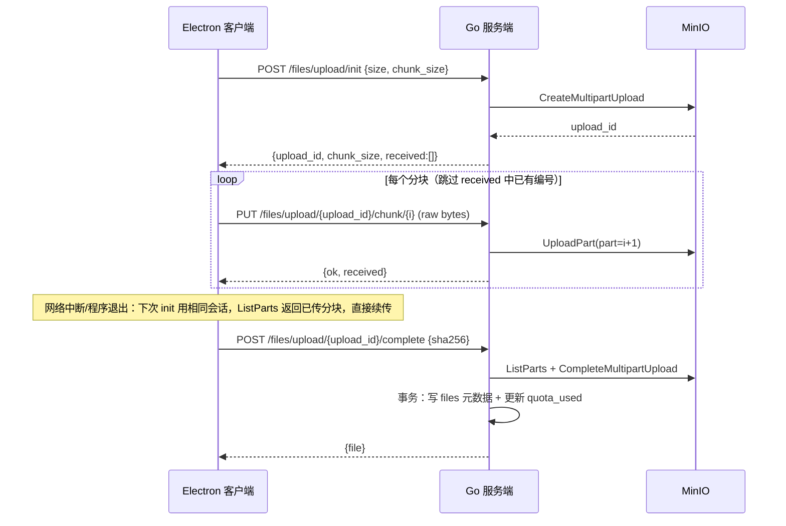
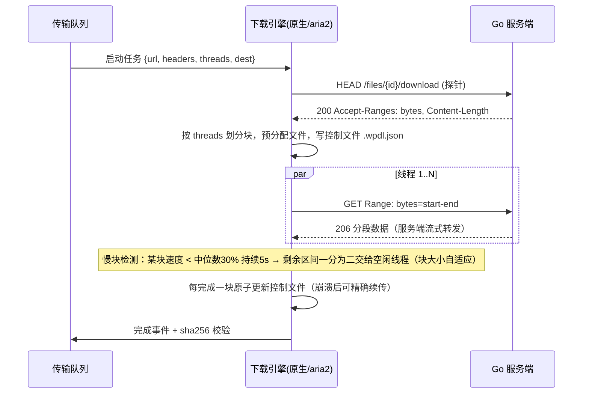

# 云栖盘 · REST API 契约 v1

> 本文档是服务端（Go）与客户端（Electron）之间唯一的接口契约。两端必须严格按此实现。
> Base URL：`http(s)://<host>:<port>/api/v1`（默认端口 8080，生产必须走 HTTPS/TLS）。

## 1. 通用约定

### 1.1 认证
- 除「注册/登录/健康检查/公开分享」外，所有接口要求请求头 `Authorization: Bearer <JWT>`。
- JWT：HS256，有效期 7 天，claims：`sub` = 用户 UUID、`exp` = 过期时间。
- 401 返回：`{"error":{"code":"UNAUTHORIZED","message":"..."}}`。

### 1.2 错误格式
所有非 2xx 响应体统一为：

```json
{ "error": { "code": "FILE_NOT_FOUND", "message": "文件不存在" } }
```

### 1.3 错误码表

| code | HTTP | 说明 |
|---|---|---|
| INVALID_INPUT | 400 | 参数缺失/非法（如文件名含非法字符） |
| UNAUTHORIZED | 401 | 未登录 / token 无效或过期 |
| FORBIDDEN | 403 | 无权限访问他人资源 |
| NOT_FOUND | 404 | 资源不存在 |
| CONFLICT | 409 | 同名文件/目录已存在 |
| QUOTA_EXCEEDED | 413 | 存储配额不足 |
| CHUNK_TOO_LARGE | 413 | 分块超过允许大小 |
| UPLOAD_NOT_FOUND | 404 | 分块上传会话不存在（可能已过期/中止） |
| SHARE_EXPIRED | 410 | 分享已过期 |
| SHARE_CODE_REQUIRED | 403 | 需要提取码 |
| SHARE_CODE_INVALID | 403 | 提取码错误 |
| SHARE_LIMIT_REACHED | 403 | 下载次数已达上限 |
| RATE_LIMITED | 429 | 触发限流（登录等） |
| NOT_SUPPORTED | 415 | 类型不支持（如不可预览类型） |
| TOO_MANY_NODES | 413 | 目录树过大（>20000 节点） |
| INTERNAL | 500 | 服务器内部错误 |

### 1.4 命名与目录规则
- 文件名/目录名：长度 ≤ 255 字节；禁止字符 `/\:*?"<>|` 及控制字符；不允许 `.`、`..`。
- 目录最大深度 64 层。
- 分块大小 `chunk_size` 允许范围：5 MiB ~ 64 MiB，默认 8 MiB（8388608）。
  > S3 Multipart 语义要求除最后一块外每块 ≥ 5 MiB，故下限取 5 MiB。

### 1.5 对象模型

```jsonc
// User
{ "id": "uuid", "username": "alice", "quota_total": 10737418240, "quota_used": 0, "created_at": "RFC3339" }
// quota_total = 0 表示不限容量

// FileMeta（文件与目录统一用此结构，目录 size=0、mime="inode/directory"、sha256=null、encrypted=false）
{ "id": "uuid", "parent_id": "uuid|null", "name": "a.txt", "is_dir": false,
  "size": 1234, "mime": "text/plain", "sha256": "hex|null",
  "encrypted": false, "created_at": "RFC3339", "updated_at": "RFC3339" }

// Share
{ "id": "uuid", "token": "8位随机串", "file_id": "uuid", "file_name": "a.txt",
  "require_code": false, "expires_at": "RFC3339|null", "max_downloads": 100, // null = 不限
  "downloads": 0, "created_at": "RFC3339" }

// ShareNode（分享树中的节点；目录分享时服务端返回整棵子树扁平数组，客户端自行组树）
{ "id": "uuid", "parent_share_id": "uuid|null", "name": "x", "is_dir": true,
  "size": 0, "mime": "inode/directory", "encrypted": false }
```

---

## 2. 认证接口

### POST /auth/register
- 请求：`{ "username": "3-32位字母数字下划线", "password": "8-72位" }`
- 成功 201：`{ "token": "jwt", "user": User }`
- 失败：409（用户名已存在，code=CONFLICT）、400（INVALID_INPUT）

### POST /auth/login
- 请求：`{ "username", "password" }`
- 成功 200：`{ "token": "jwt", "user": User }`
- 失败：401 `UNAUTHORIZED`；Redis 可用时限流：同 IP 5 次/分钟，超限 429 `RATE_LIMITED`

### GET /auth/me
- 成功 200：`{ "user": User }`（含最新配额使用量）

---

## 3. 文件接口（全部需要 Bearer）

### GET /files?parent_id=<uuid>
- 不传 `parent_id` 表示根目录（parent_id = NULL）。
- 成功 200：`{ "items": [FileMeta...] }`，排序：目录在前、名称升序。

### GET /files/tree
- 返回当前用户全部文件/目录的扁平数组（用于同步等场景）。
- 成功 200：`{ "items": [FileMeta...] }`；节点数 > 20000 时 413 `TOO_MANY_NODES`（客户端应退化为逐目录拉取）。

### GET /files/{id}
- 成功 200：`{ "file": FileMeta }`；404 `FILE_NOT_FOUND`；403 他人文件。

### POST /files/mkdir
- 请求：`{ "parent_id": "uuid|null", "name": "docs" }`
- 成功 201：`{ "file": FileMeta }`；409 同名冲突。

### POST /files/rename
- 请求：`{ "id": "uuid", "name": "新名" }`
- 成功 200：`{ "file": FileMeta }`

### POST /files/move
- 请求：`{ "id": "uuid", "parent_id": "uuid|null" }`
- 服务端必须校验：目标目录存在且属于当前用户；不能把目录移动到自己的子孙目录（防环）；409 同名冲突。

### DELETE /files/{id}?recursive=true
- 文件直接删；目录必须带 `recursive=true`，否则 400。
- 服务端：递归收集子孙 → 删除 MinIO 对象 → 事务内删行并扣减 quota_used。
- 成功 200：`{ "ok": true }`

### GET /files/{id}/download?download=1
- 支持标准 HTTP Range：`Range: bytes=start-end`、`If-Range`；返回 200 或 206。
- 响应头：`Accept-Ranges: bytes`、`Content-Type: <mime>`、`ETag`（优先用 sha256，否则对象 ETag）、`Content-Length`（200 时为全长，206 时为分段长度）、`Content-Range`（206）。
- `download=1` 时 `Content-Disposition: attachment; filename*=UTF-8''<RFC5987编码>`；否则 inline。
- 单请求读块上限：流式 io.Copy，不做全量缓冲。

### GET /files/{id}/preview
- 同 download（inline、支持 Range），但仅允许预览白名单 mime：
  `image/*`、`video/*`、`audio/*`、`text/plain`、`text/markdown`、`text/csv`、`application/pdf`、`application/json`、`application/xml`。
- 其余类型 415 `NOT_SUPPORTED`。
- 加密文件（encrypted=true）一律 415。

### POST /files/{id}/preview-token
- 请求：`{ "ttl_seconds": 300 }`（默认 300，上限 3600）
- 成功 200：`{ "url": "/api/v1/files/{id}/preview?token=<sig>&exp=<unix>", "expires_at": "RFC3339" }`
- 说明：`token = base64url( HMAC-SHA256(PREVIEW_TOKEN_SECRET, "{id}|{exp}") )`。
  带合法 token 的 GET /files/{id}/preview 可免 Bearer（用于渲染进程 iframe 预览，iframe 无法带自定义头）。
  token 只能用于 preview，不能用于 download。

---

## 4. 分块上传接口（全部需要 Bearer）

> 服务端使用 MinIO S3 Multipart API 承接分块（CreateMultipartUpload / UploadPart / ListParts /
> CompleteMultipartUpload / AbortMultipartUpload），断点续传状态天然保存在对象存储中，
> 客户端通过 `received` 字段获知已完成的分块编号（0 基），跳过已传分块即可续传。

### POST /files/upload/init
- 请求：`{ "parent_id": "uuid|null", "name", "size", "mime", "sha256?", "encrypted": false, "chunk_size?": 8388608 }`
- 服务端：校验配额（quota_used + size ≤ quota_total，quota_total>0 时）→ CreateMultipartUpload。
- 成功 201：`{ "upload_id": "s3-multipart-id", "chunk_size": 8388608, "received": [0,2,5] }`
  （received 来自 ListParts 的 part numbers 减 1；新会话为空数组）

### PUT /files/upload/{upload_id}/chunk/{index}
- `index` 从 0 开始；请求体为该块原始字节（最后一块可以小于 chunk_size）。
- 单块 ≤ chunk_size，超出 413 `CHUNK_TOO_LARGE`。
- 服务端：UploadPart(partNumber = index+1)，幂等（重复 PUT 同块覆盖即可）。
- 成功 200：`{ "ok": true, "received": [0,1,2] }`

### GET /uploads/{upload_id}
- 用于客户端恢复上传现场。
- 说明：该端点与 /files/{id}/download、/files/{id}/preview 在 Go 1.22 ServeMux 中存在路径模式冲突
  （/files/upload/download 会同时命中两个模式），故置于 /uploads 命名空间下。
- 成功 200：`{ "upload_id", "chunk_size", "received": [...], "name", "size", "parent_id", "encrypted" }`

### POST /files/upload/{upload_id}/complete
- 请求：`{ "sha256?": "hex" }`
- 服务端：ListParts 取全部 ETag → CompleteMultipartUpload → 事务：插入 files 行（object_key 指向最终对象）+ 校验配额并更新 quota_used。
- 成功 200：`{ "file": FileMeta }`；配额不足 413 `QUOTA_EXCEEDED`（并中止上传）。
- 完成后清理 uploads 前缀中间状态（S3 会自动合并，无需额外对象）。

### DELETE /files/upload/{upload_id}
- AbortMultipartUpload。成功 200：`{ "ok": true }`

---

## 5. 分享接口

### 创建/管理（需要 Bearer）

#### POST /shares
- 请求：`{ "file_id": "uuid", "require_code": false, "extract_code?": "4-8位", "expires_hours?": 0, "max_downloads?": 0 }`
  - `require_code=true` 时 `extract_code` 必填；0/缺省 = 永久 / 不限次。
  - 服务端只存 bcrypt(extract_code)，绝不存明文。
- 成功 201：`{ "share": Share, "url": "/s/{token}" }`（客户端拼 `SHARE_BASE_URL + url` 展示完整链接）

#### GET /shares
- 成功 200：`{ "shares": [Share...] }`（含 file_name，便于展示）

#### DELETE /shares/{id}
- 成功 200：`{ "ok": true }`；只能删除自己的分享。

### 公开访问（免 Bearer）

#### POST /shares/resolve
- 请求：`{ "token": "xxx", "extract_code?": "1234" }`
- 服务端依次校验：分享存在 → 未过期 → require_code 时提取码必填且 bcrypt 比对 → 剩余下载次数 > 0。
- 成功 200：
  ```json
  { "share": { "token": "xxx", "file_name": "docs", "is_dir": true, "size": 12345,
               "expires_at": null, "remaining_downloads": 100 },  // null = 不限
    "tree": [ ShareNode... ] }   // 单文件分享 = 数组含 1 个节点
  ```
- 失败：404 `NOT_FOUND`、410 `SHARE_EXPIRED`、403 `SHARE_CODE_REQUIRED` / `SHARE_CODE_INVALID` / `SHARE_LIMIT_REACHED`。

#### GET /shares/{token}/download?node=<shareFileId>&download=1
- 与 /files/{id}/download 行为一致（Range/206/ETag/Content-Disposition）。
- 下载计数：当 `Range` 头缺失或起始为 0（即新一轮下载）时，事务内
  `UPDATE shares SET downloads=downloads+1 WHERE id=? AND (max_downloads IS NULL OR downloads < max_downloads)`，
  影响行数为 0 → 403 `SHARE_LIMIT_REACHED`。Range 续传（start>0）不重复计数。
- `node` 必须在该分享的子树内，否则 404。

#### GET /s/{token}（浏览器分享页，非 /api 前缀）
- 服务端渲染 HTML（html/template + 少量原生 JS，全部输出转义防 XSS）：
  - 无提取码分享：页面直接 POST resolve 并渲染文件树 + 下载链接；
  - 有提取码：先展示提取码输入框，校验通过后渲染树；
  - 过期/超次显示对应中文提示。

---

## 6. 健康检查

### GET /healthz
- 成功 200：`{ "ok": true, "version": "1.0.0", "time": "RFC3339" }`
- 依赖（PG/Redis/MinIO）任一不可用时 503：`{ "ok": false, "deps": { "postgres": false, ... } }`

---

## 7. 客户端与服务端关键交互时序

### 7.1 大文件分块上传（断点续传）



### 7.2 多线程分块下载（自研内核 / aria2）



---

## 8. 合规边界（解析器与加速模块）

1. 解析器只处理**公开分享链接**：仅抓取匿名访客即可访问的公开页面/官方公开接口返回的内容。
2. 提取码由用户主动输入，仅调用页面自身使用的公开校验接口；**绝不**实现任何逆向签名算法、
   绝不复用他人登录 Cookie、绝不涉及会员/VIP/私密资源破解。
3. 解析/加速模块默认禁用，可在设置中独立开启/关闭；关闭后私有云盘全部功能不受影响。
4. 资源不提供匿名直链时，适配器返回明确错误并引导使用官方客户端。
